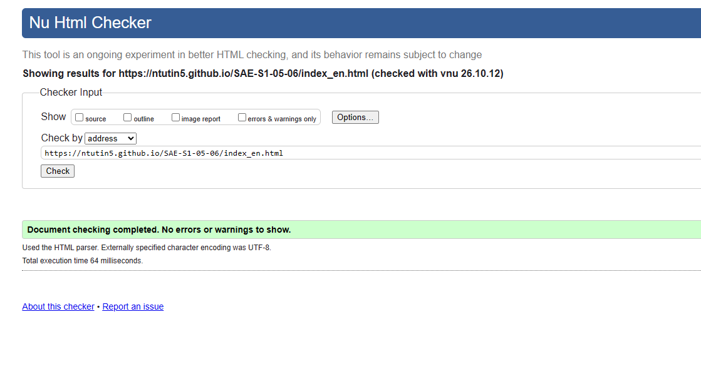
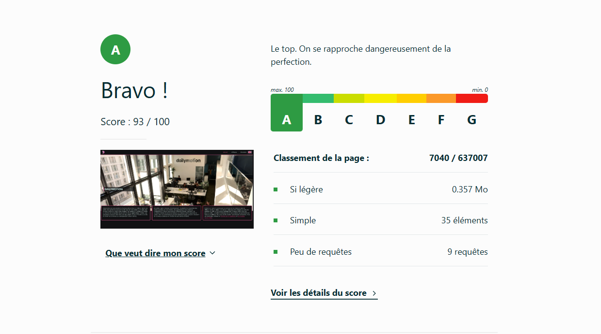
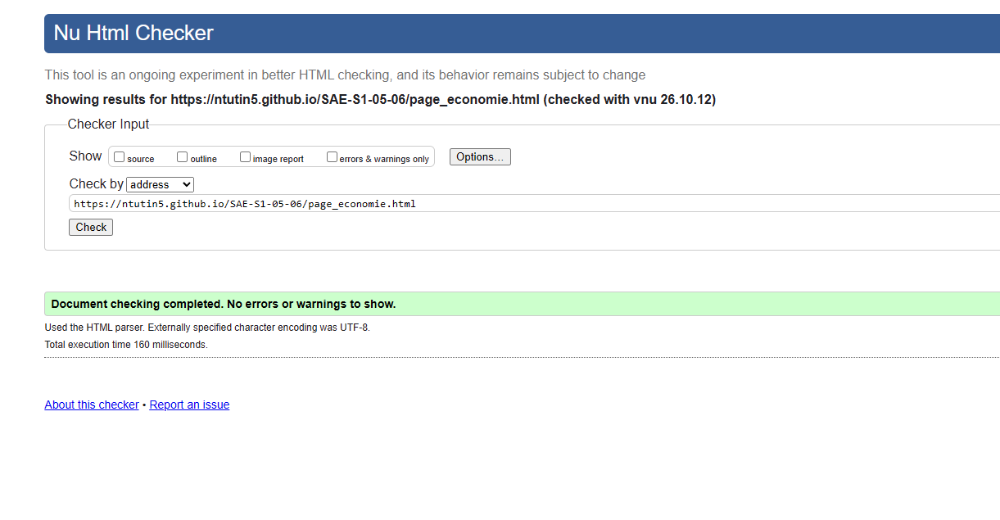
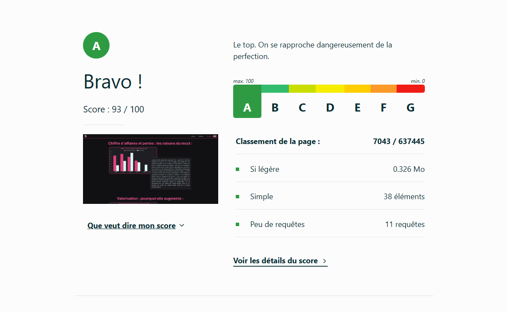
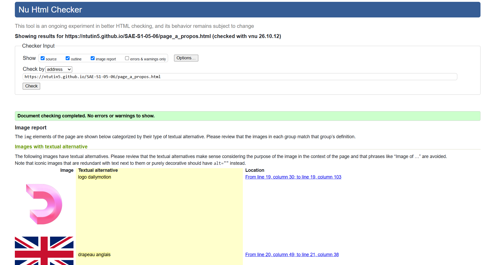
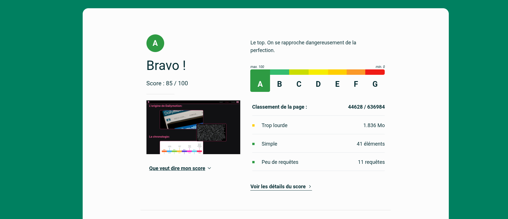
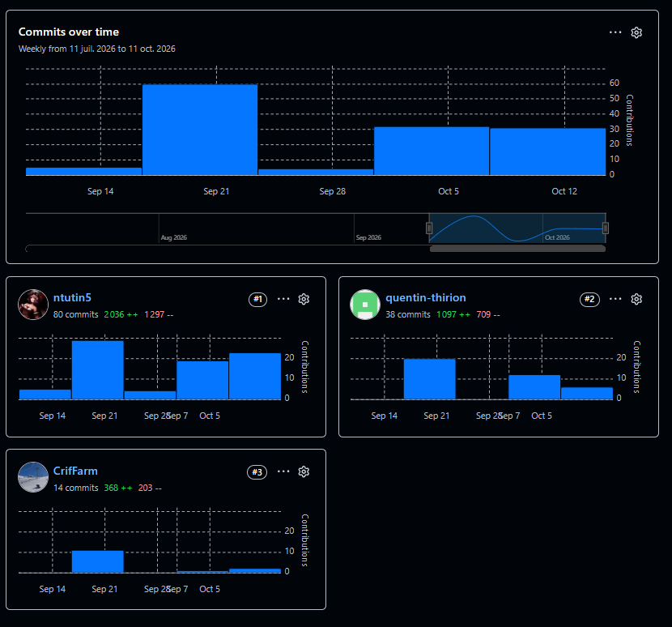

# S1-SAE-05-06  

## Site vitre de présentation de DailyMotion

[DailyMotion](https://ntutin5.github.io/SAE-S1-05-06/)

[DailyMotion gitlab](https://sae-s1-05-06-b2d3cf.gitlab.io/index.html)

## Membres du groupe :

[TUTIN Nathan (référent)](mailto:nathan.tutin@edu.univ-fcomte.fr?subject=SAE_S1_05_06)

[THIRION Quentin](mailto:quentin.thirion@edu.univ-fcomte.fr?subject=SAE_S1_05_06) 

[RIFFIOD Clément](mailto:clement.riffiod@edu.univ-fcomte.fr?subject=SAE_S1_05_06)

## Présentation 

Ce dépôt correspond à un site web créé en HTML/CSS/JS dans le cadre de la SAÉ 05-06 à l'IUT de Belfort-Montbéliard. Ce site présente des informations concernant l'entreprise DailyMotion et sert de vitrine pour présenter l'entreprise, ses activités, son économie et son historique.

## Choix de conception  

Pour la conception du site, nous nous sommes grandement inspirés du site officiel de DailyMotion (disponible [ici](https://www.dailymotion.com/fr)), du site du site de [notion calendar](https://www.notion.com/product/calendar) et nous avons pris la charte graphique du site de [rive](https://www.rive.app/).    

## Développement Site Web et Validation des pages

### Page d'accueil

**Auteur : TUTIN Nathan**  

Vérification W3C : [Détail ICI](https://validator.w3.org/nu/?doc=https%3A%2F%2Fntutin5.github.io%2FSAE-S1-05-06%2Findex_en.html)

 

 

<!--  style="width=400px" ne fonctionne pas -->

### Présentation économie

**Auteur : RIFFIOD Clément**  

Vérification W3C : [Détail ICI](https://validator.w3.org/nu/?doc=https%3A%2F%2Fntutin5.github.io%2FSAE-S1-05-06%2Fpage_economie.html)

 

 

### Présentation générale

**Auteur : THIRION Quentin**  

Vérification W3C : [Détail ICI](https://validator.w3.org/nu/?showsource=yes&showoutline=yes&showimagereport=yes&doc=https%3A%2F%2Fntutin5.github.io%2FSAE-S1-05-06%2Fpage_a_propos.html)

 

 

## Répartition du travail

### Planification - Diagramme de GANTT

- TUTIN Nathan

### Recherches d'informations

- THIORION Quentin
- RIFFIOD Clément
- TUTIN Nathan

### Développement site

- TUTIN Nathan
  - Page d’accueil
  - "Template" de page (Navbar/Footer)
  - Page présentation
- THIRION Quentin
  - Page à propos
- RIFFIOD Clément
  - Page économie

## Contributeurs

